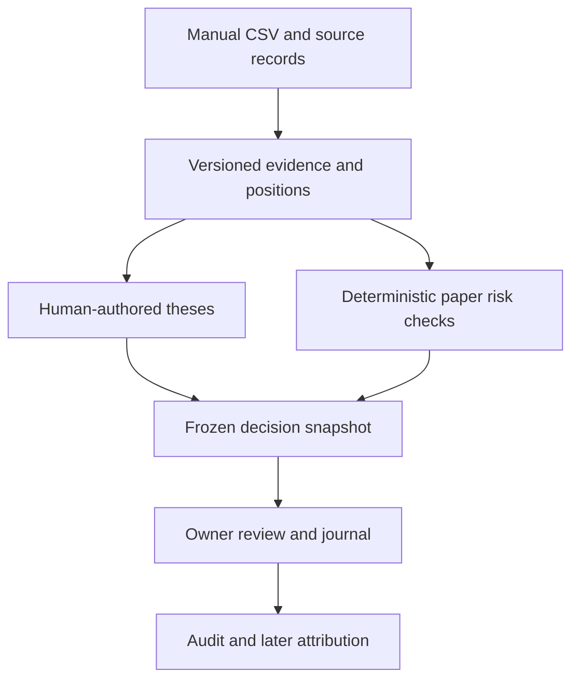

# Architecture and research roadmap

## Operating principles

Separate three claims: reliable records, improved decision discipline, and investment returns. The first two can be tested without asserting the third. No AI-generated probability, current quote, live opportunity or broker position is fabricated in this foundation.

Language models will extract, compare and explain evidence. Numerical forecasts will be versioned research models. Risk limits and order authorization remain deterministic code. Agent agreement is not independent evidence.

## Current implementation

- `app/domain.py`: typed-by-validation input contracts, Decimal arithmetic, exposure/freshness checks, paper-entry assessment.
- `app/storage.py`: SQLite WAL, transactional writes, optimistic versions and append-only audit triggers.
- `app/security.py`: PBKDF2 password hashes, fail-closed production configuration.
- `app/web.py`: WSGI API, hashed expiring server sessions, same-origin writes, fixed static routes and review-time checks.
- `app/static/`: dependency-free responsive client, text-node rendering of user content, accessible forms and modal dialogs.
- `tests/`: behavioral checks for data integrity and consequential boundaries.

Records are JSON documents in a keyed SQLite record table, with explicit application validation and frozen snapshots. This supports an inexpensive single-owner foundation. A later normalized PostgreSQL schema and migration must be designed before multi-user/high-volume ingestion; do not pretend the current store already supplies that scale.

Evidence records are immutable through the API. Corrections are new records linked through a revised thesis. Decisions preserve the original thesis, sources, portfolio and risk settings; review adds metadata without changing that snapshot. Journal entries are append-only through the API. Audit triggers prevent ordinary SQL updates/deletes, but do not make the database tamper-proof against someone who controls the server.

## Data flow

Acceptance means accepting a paper record. It never sends an order, simulates a fill or changes the portfolio. Entry acceptance rechecks expiry, current thesis version, a reviewed non-inference source link, fresh marks and current allocation limits. Classification/review is entered by the owner and is not independent source verification.

## Milestones and gates

| Phase | Deliverable | Gate |
| --- | --- | --- |
| Foundation (this version) | Private record keeping, paper exposure and decision history | Integrity/authentication checks pass; reachable-host UI QA |
| Data truth | Provider adapters, source snapshots, symbol/contract mapping, corporate actions, cache/rate budgets | Historical as-of reconstruction; stale/missing data visible |
| Research baseline | One 5–20-day hypothesis and implementable market/sector/momentum baselines | Chronological evaluation, realistic costs, no known leakage |
| Advanced evidence | Expectations changes and verified economic relationships | Feature ablation shows incremental usefulness |
| Forward paper evaluation | Frozen forecasts, simulated fills, attribution and model lifecycle | Sufficient independent observations and calibrated uncertainty |
| Limited live support | Current account mirror and evidence-supported decisions | Explicit risk policy; separate execution authorization and reconciliation |

Initial hypothesis: measurable improvements in business expectations, combined with industry-relative strength and a viable entry, might predict positive sector-adjusted returns after costs over 5–20 trading days. This is unproven. Compare with simple alternatives, and retire it if evidence fails.

## Data requirements for the next phase

Store publication, ingestion and effective dates separately. Preserve raw payloads, restatements, corporate actions and universe membership, including delistings. Do not use today's consensus estimates to reconstruct historical expectations. Where historical data are unavailable, begin collecting snapshots and disclose the testing limitation.

Use configurable provider limits and incremental caching. Keep privileged keys on the server. A paid plan does not establish historical coverage or redistribution rights. Review the intended license before public or multi-user data display.

Recommended initial connectors: primary filings, licensed prices/corporate actions, public company releases, then historical analyst estimates only if available and economically justified. Positioning/options inputs are optional research features, never guaranteed support/resistance levels.

## Validation requirements

- Registry of all hypotheses, variants, selections and failures.
- Point-in-time universe and data; costs, financing, delays and adverse gaps.
- Walk-forward splits; purge overlapping labels and apply appropriate embargoes.
- Risk/sector-matched benchmarks and tests of cost sensitivity.
- Proper probability scores, interval coverage, ranking quality and dependence-aware uncertainty.
- Forward records and separate paper/live execution accounting.
- Promotion, deterioration and retirement policies fixed before reviewing outcomes.

A drawdown objective is a planning constraint, not a guaranteed loss ceiling. Research and product quality should be reported separately from unproven alpha.

## Future service boundary

Keep a modular application until scaling justifies services. Heavy ingestion/backtesting and persistent feeds belong in cloud workers; the web app serves authorized stored results. Use a durable job queue and database. Any execution adapter must persist order intent, bind approval to precise limits and expiry, and reconcile after timeouts before retrying.

Capital.com currently documents trading-enabled API keys without read-only keys. Even a future monitoring adapter needs endpoint restrictions. No broker adapter, API credential or order route is present in this release.
